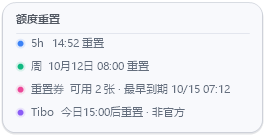
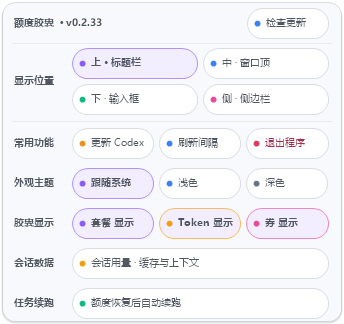
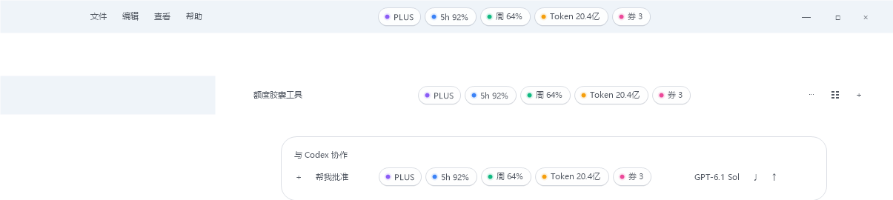
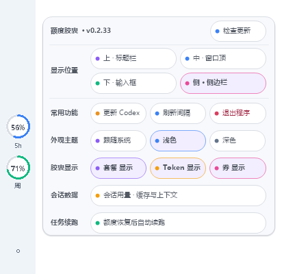
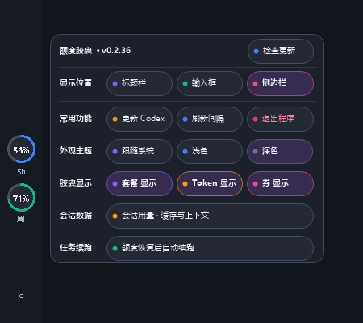
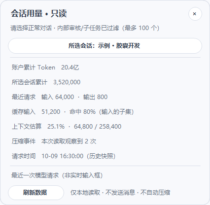
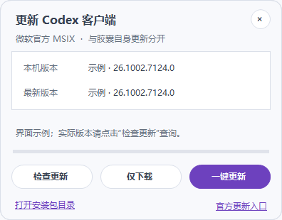

# Codex Quota Pills

Windows 版 Codex 的额度胶囊：把 **5 小时额度、周额度、账户累计 Token 和可用重置券**放在 Codex 窗口旁边，也能查看所选会话的用量、缓存输入和上下文估算。

**最新正式版：[v0.2.33](https://github.com/jinfu0111-gif/CodexQuotaPills/releases/tag/v0.2.33)** · [下载便携版](https://github.com/jinfu0111-gif/CodexQuotaPills/releases/download/v0.2.33/CodexQuotaPills-0.2.33-portable.zip) · [安装与排查](INSTALL.md) · [更新记录](CHANGELOG.md)


胶囊跟随 Codex 窗口移动；切到其他程序或最小化 Codex 时隐藏，回到 Codex 后恢复。本文配图由 **0.2.33 的真实控件离屏绘制**，使用示例数据；栏位配图中的窗口装饰是示意。

> 非官方社区项目，与 OpenAI 无隶属或背书关系。0.2.33 修复了 0.2.32 鼠标移入胶囊或菜单时的栈溢出崩溃，使用 0.2.32 的用户应升级。

## 安装与升级

需要 Windows 10/11、.NET Framework 4.7.2 或更高版本，以及已登录的 Windows Codex 和可用的 `codex app-server`。普通使用无需 Git、源码编译或管理员权限。

### 让 Codex 帮你安装

在 Windows 本机 Codex 中复制发送：

> 帮我安装并启动 https://github.com/jinfu0111-gif/CodexQuotaPills ，按仓库 INSTALL.md 执行，确认额度连接和胶囊显示是否成功。

安装入口为仓库根目录 `install.ps1`。它下载正式便携 Release，校验 SHA-256、大小、解压路径和程序版本，默认安装到 `%LOCALAPPDATA%\Programs\Codex Quota Pills\versions\…`，创建开始菜单入口。新安装会暂停自动续跑；已有显示设置、旧版本和续跑记录会保留。需要开机启动时，在安装请求中补充“设置登录 Windows 后自动启动”。

完整脚本步骤、固定版本回退和 Agent 检查方式见 [INSTALL.md](INSTALL.md)。安装完成、额度连接成功、进程运行和实际可见是四项不同结果，进程存在不代表胶囊已经显示。

### 手动使用便携版

1. [下载 0.2.33 便携 ZIP](https://github.com/jinfu0111-gif/CodexQuotaPills/releases/download/v0.2.33/CodexQuotaPills-0.2.33-portable.zip)，解压到长期保留的可写目录。
2. 双击 `CodexQuotaPills.exe`，再打开已登录的 Windows Codex，把 Codex 放到前台。
3. **点击蓝色 `5h` 打开菜单**。套餐 `PLUS` 仅展示套餐，不再是菜单入口。
4. 想要最简显示，在菜单“胶囊显示”中隐藏套餐、Token 和券；需要时随时恢复。

程序自带后台监听：Codex 启动后显示胶囊，退出两秒后关闭显示界面；Codex 更新重启或显示进程异常退出后会尝试恢复。点击菜单“退出程序”会同时停止监听。

**手动首次运行且没有已有续跑账本时，程序默认启用自动续跑。** 若只想查看额度，先在 5h →“额度恢复后自动续跑”中暂停；通过安装脚本首次安装则预先暂停。已有账本中的开关会跨版本保留，详情见下文。

### 从旧版升级

优先使用 5h 菜单顶部的“检查更新”，或请 Codex 按 INSTALL.md 安装新版。它们会保留显示设置和共享续跑记录，拒绝降级。**0.2.24 等旧版的菜单入口仍是 PLUS**；升级到 0.2.33 后统一点击 5h。

手动换目录时，先从旧胶囊菜单退出程序，再解压到新目录；需要保留外观时，把旧目录的 `settings.ini` 复制到新目录后再启动。共享续跑记录留在用户目录，不要清空。原快捷方式也应指向新 EXE；仅解压不会自动迁移设置或修改启动入口。保留旧目录便于回退，避免覆盖正在运行的文件。

## 胶囊怎么看、怎么点

| 胶囊 | 数字含义 | 操作 |
| --- | --- | --- |
| 紫色套餐，如 `PLUS` | 当前账户套餐 | 可隐藏；不承担菜单入口 |
| 蓝色 `5h` | 5 小时额度的**剩余**百分比 | 点击打开统一菜单 |
| 绿色 `周` | 周额度的**剩余**百分比 | 悬停查看重置时间、券汇总和 Tibo 信息 |
| 橙色 `Token` | 当前账户累计 Token | 点击打开会话用量面板 |
| 粉色 `券` | 当前可用重置券数量 | 悬停查看每张券的到期时间 |

剩余额度不超过 20% 时圆点变橙色，用尽时变红色。未知数据用 `—` 或“待确认”表示，不当作 0；已确认没有可用券时可以显示 `券 0`。

窗口变窄时依次收起 Token、券、套餐，再收起周额度，始终优先保留 5h 菜单入口。可选项设置为“显示”表示允许展示；数据未知或空间不足时仍可能暂时省略。



悬停周额度可看两档额度重置、可用券数量及最早到期时间，移开鼠标收起。悬停粉色券则逐张显示到期时间，按本机时区排序；同一时间到期的多张券分别列出，缺失的日期标注“到期时间待刷新”。程序只展示券信息，不自动使用券。


## 用 5h 菜单调整显示



| 入口 | 用途 |
| --- | --- |
| 显示位置：上 / 中 / 下 / 侧 | 在标题栏、对话顶部、输入框附近或最左窄侧栏显示 |
| 外观主题：跟随系统 / 浅色 / 深色 | 同时调整胶囊、菜单、悬停卡和自建弹窗 |
| 胶囊显示：套餐 / Token / 券 | 三个独立开关；点击立即生效并保存，菜单保持展开 |
| 刷新间隔 | 设置额度刷新频率，回看“使用指引” |
| 顶部“检查更新” | 检查并更新胶囊自身的 GitHub 正式版 |
| 更新 Codex | 检查 Windows Codex 客户端更新 |
| 会话用量 · 缓存与上下文 | 选择对话，查看只读用量详情 |
| 额度恢复后自动续跑 | 查看候选任务、暂停 / 恢复续跑、取消候选任务 |
| 退出程序 | 关闭显示界面和后台监听 |

显示位置、外观和显示开关会跨重启保存。隐藏套餐、Token 和券即可得到仅含 5h 与周额度的极简模式；隐藏只改变显示，不停止数据读取或续跑。跟随系统读取 Windows 应用主题，Codex 自己的主题设置可能与它不同。完成过的使用指引不会因升级再次自动弹出。


### 四种显示位置

上、中、下使用横排胶囊，分别在系统标题栏空隙、对话内容顶部、输入框工具栏附近对齐，跟随窗口大小和 DPI 变化。空间不足时收起可选统计，避免遮挡原生按钮。



**侧栏模式只显示 5h、周两枚圆环**：圆心是剩余百分比，名称在下方。点击 5h 圆环打开菜单，悬停周圆环查看详情；Token 和券汇总仍可从详情查看，会话用量仍可从 5h 菜单进入。横排显示开关会保留，切回上中下时恢复。





侧栏弹窗向右展开，空间不足时避让，大面板可滚动。窄栏无法识别、窗口太小（逻辑高度低于 700 像素）或位置超出屏幕时会暂时隐藏；识别恢复后自动显示。隐藏期间可从系统托盘选择“返回标题栏”，或双击托盘图标恢复。

胶囊是独立覆盖层，不修改 Codex 页面，也不为原生控件预留空间。侧栏定位会在内存中短暂读取窄栏边界的少量画面，不保存或上传画面、不识别聊天文字。不同客户端布局和多显示器组合仍可能需要调整位置。

## 会话用量、缓存与上下文

点击 Token，或 **5h →“会话用量 · 缓存与上下文”**，从列表选择一个对话。列表显示最多 100 个未归档正常对话，按结构化来源排除 Guardian 内部审批审核和其他子任务；不按标题过滤，不删除审核记录。



面板明确显示“所选会话”，**需要手动选择，尚不能可靠自动识别屏幕上当前对话**。选择在当前胶囊进程内保留；面板每 15 秒刷新，标注最近请求时间。

| 数据 | 应怎样理解 |
| --- | --- |
| 账户累计 Token | 当前账户总量；不是所选会话上下文 |
| 所选会话累计 | Codex 维护的会话累计值；不是一次请求的大小 |
| 最近请求输入 / 输出 | 最近一条完整有效请求的统计；不包括尚未发送的输入 |
| 缓存输入 / 命中率 | 缓存是输入的子集，不再加到输入总量；命中率不等于上下文缩短比例 |
| 上下文估算 | 最近请求总量与上下文窗口的原始比例；不是实时输入框状态或精确剩余可输入量 |
| 压缩事件 | 有限日志读取中观察到的次数；标注部分历史时不能当成完整历史 |

压缩后尚无新请求数据时显示等待，不沿用旧上下文。日志最多扫描末尾 8 MB，缺失或未验证的数字不编造。账户累计 Token 的首次零值或正数突然变零时先显示“待确认”，同账户间隔至少 5 秒的两次观察后再确认零值。

会话面板只读本机数据，不主动压缩、不注入页面、不发送任务，也不把 Token 换算成 Plus 额度消耗。来源、路径校验和隐私边界见 [会话数据说明](docs/session-usage.md)。

## 两种更新：胶囊和 Codex 客户端

**更新胶囊**：5h 菜单顶部“检查更新” → 下载并校验 → 启用新版本。后台最多每 24 小时检查一次，下载和启用需主动点击。只接受本仓库稳定 Release 的便携 ZIP、GitHub SHA-256 和一致的程序版本；草稿、预发布和旧版本不会作为升级目标。

新版安装在 `%LOCALAPPDATA%\CodexQuotaPills\GitHubUpdates` 的独立目录，迁移显示设置，备份并切换原来指向旧胶囊的 Startup 入口。没有 Startup 入口时不额外创建。旧版本及共享续跑记录保留，失败时尝试恢复，结果写入更新目录的 `result.json`。网络或 API 限流时，也可从正式 Release 手动下载。

**更新 Codex**：5h →“更新 Codex” → 检查更新，可选择仅下载安装包或执行 MSIX 更新。安装需主动点击，不会静默关闭正在运行的 Codex；系统可能要求权限确认。下载缓存重复使用前仍会检查摘要和包身份。



## 额度恢复后自动续跑

5h →“额度恢复后自动续跑”打开管理面板。关闭面板不等于暂停；主动暂停会跨重启保留，取消候选任务会保留防重复记录。


它启动约 1 秒后检查，此后每 30 秒检测最近最多 500 个未归档根对话，只识别最新执行的结构化 `usageLimitExceeded` 失败。实时确认 5h 与周额度恢复后，重新检查原轮次、任务状态、对话 owner 和原设置，再向原对话发送固定续跑消息。

- 手动停止、已完成、仍在执行、等待审批、子任务和远程任务不会续跑；原对话需由 Codex 桌面加载。
- 使用原对话的模型、权限和审批机制，不回答审批、不使用重置券、不切换账户。
- 每个失败轮次最多尝试一次，每个对话累计最多 3 次；发送意图先落盘，结果不确定时不重发。
- 账本位于 `%LOCALAPPDATA%\CodexQuotaPills\AutoResume\ledger.json`，包含开关、取消与计数；损坏、写入失败或账户变化时停止发送，不自行清空。
- 每次连接检查官方 WindowsApps 服务路径和桌面协议合约；不兼容时停止。已完成只读握手的客户端版本及维护方法见 [兼容性说明](docs/desktop-ipc-compatibility.md)。

**程序没有既有账本时默认启用；安装脚本新安装时预先暂停；已有账本保持原开关。** 想只看额度，请在该面板暂停。策略测试、隔离模拟发送和真实客户端只读扫描已验证；真实额度耗尽到自然重置的完整续跑过程尚未完成验证。用户操作与发送不能保证完全原子互斥，有排队消息或重要待确认任务时可先暂停。

## Tibo 重置信息

日常信息在周额度悬停卡查看。新的有效公告会弹出一次浅色横幅，**10 秒后自动关闭**，也可点击右侧圆形 ×；启动已有公告、持续轮询、重启或手动关闭不会反复提醒。


这属于非官方公开信息，不代表你的账户实际恢复，也不触发续跑。只接受固定 HTTPS 数据源 `https://didcodexreset.com/api/status.json` 中带 Tibo 原帖的有效事件；缓存、离线或过期信息不会当作有效预告。更多效果见 [横幅说明](docs/reset-radar-banner-preview.md)。

## 不显示或数字异常时

- 把已登录的 Windows Codex 放到前台。切到其他程序或最小化后隐藏属于正常行为。
- 若旧版还在运行，先从旧胶囊菜单退出，再启动新版；不要同时运行多个目录的实例。
- 侧栏隐藏时，从托盘返回标题栏；找不到窄栏不代表额度连接失败。
- 账户 Token 显示“待确认”时等待下一次刷新；未知数据不会自动当成零。
- 会话面板没有数字时，先选择正常对话，并留意读取失败、等待新请求或部分历史提示。
- 桌面工具确认不了可见性时，从资源管理器双击已校验 EXE 实测；详细日志与排查步骤见 [INSTALL.md](INSTALL.md)。

日常设置在程序目录的 `settings.ini`，额度缓存和诊断快照可能包含个人账户数字。程序日志与共享续跑账本放在本机用户目录。向他人分享时使用 Release ZIP，不要直接压缩正在使用的目录。

## 数据与开源

额度通过本机 `codex app-server` 读取；会话用量通过只读 SQLite 元数据和有限日志扫描读取。日志文件本身可能包含聊天内容，实现只在内存中筛选数字事件，不解析、展示、保存或上传非数字消息正文。程序不保存认证令牌、Cookie 或浏览器存储，不修改 Codex 安装文件和数据库。

网络访问用于公开重置信息、GitHub 更新，以及用户打开更新面板后的微软分发服务，不上传本机账户或对话数据。更多边界见 [SECURITY.md](SECURITY.md)，杀毒误报处理见 [FALSE_POSITIVE_GUIDE.md](FALSE_POSITIVE_GUIDE.md)。

本项目基于 `ivan51769/CodexUsageOverlay v1.3.6` 的 AGPL-3.0 代码继续开发。`jlcodes99/cockpit-tools` 仅提供产品方向参考，未复制其源码；会话读取也参考了公开实现的思路。采用 [GNU AGPL v3.0](LICENSE)，完整来源和复用许可证见 [NOTICE.md](NOTICE.md)、[THIRD_PARTY_NOTICES.md](THIRD_PARTY_NOTICES.md)。

## 开发与打包

仅开发者需要源码构建。普通用户下载便携版即可。Windows 上执行：

```powershell
.\build.ps1
.\test.ps1 -Executable .\bin\CodexQuotaPills.exe
.\tests\InstallTests.ps1
.\tools\export-ui-previews.ps1
.\tools\package-release.ps1 -Version 0.2.33
```

构建输出 `bin\CodexQuotaPills.exe`。产物参数会额外检查实际程序集的两处指针消息分支；预览脚本使用示例数据离屏绘图，不启动生产服务。打包生成便携 ZIP、源码 ZIP 和 SHA-256 文件，拒绝覆盖已有版本，只复制公开允许列表，不装入本机设置、续跑账本或维护交接。

诊断 `--snapshot` 会生成包含账户数字的 `snapshot.txt`，公开前应检查。维护约定、贡献流程见 [CONTRIBUTING.md](CONTRIBUTING.md)。正式发布需维护者明确要求；发布从干净的 GitHub main 正常追加提交，并核对 Release 资产摘要。
